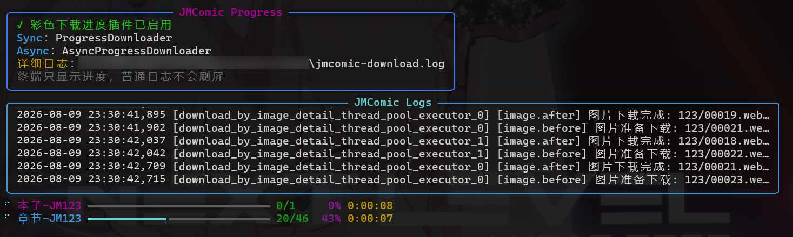

<!-- 顶部标题 & 统计徽章 -->
<div align="center">
  <h1 style="margin-top: 0" align="center">Python API for JMComic</h1>

  <p align="center">
    <strong>简体中文</strong> •
    <a href="./assets/readme/README-en.md">English</a> •
    <a href="./assets/readme/README-jp.md">日本語</a> •
    <a href="./assets/readme/README-kr.md">한국어</a>
  </p>

  <p align="center">
  <strong>提供 Python API 访问禁漫天堂（网页端 & 移动端），集成 GitHub Actions 下载器🚀</strong>
  </p>

[](https://github.com/hect0x7)
[](https://github.com/hect0x7/JMComic-Crawler-Python/stargazers)
[](https://github.com/hect0x7/JMComic-Crawler-Python/forks)
[](https://github.com/hect0x7/JMComic-Crawler-Python/releases/latest)
[](https://pepy.tech/projects/jmcomic)
[](https://github.com/hect0x7/JMComic-Crawler-Python)
[](https://github.com/hect0x7/JMComic-Crawler-Python/network/dependents)

</div>


> 本项目封装了一套可用于爬取JM的Python API.
> 
> 你可以通过简单的几行Python代码，实现下载JM上的本子到本地，并且是处理好的图片。
> 
> **🧭 快速指路**
> - [教程：使用 GitHub Actions 下载禁漫本子](./assets/docs/sources/tutorial/1_github_actions.md)
> - [教程：导出并下载你的禁漫收藏夹数据](./assets/docs/sources/tutorial/10_export_favorites.md)
> - [教程：下载后转为 PDF / ZIP / 长图](./assets/docs/sources/tutorial/13_export_and_feature.md)
> - [塔台广播：欢迎各位机长加入并贡献代码](./.github/CONTRIBUTING.md)
> 
> **友情提示：珍爱JM，为了减轻JM的服务器压力，请不要一次性爬取太多本子，西门🙏🙏🙏**.
> 


## 项目介绍

本项目的核心功能是下载本子。

基于此，设计了一套方便使用、便于扩展，能满足一些特殊下载需求的框架。

目前核心功能实现较为稳定，项目也处于维护阶段。

除了下载功能以外，也实现了其他的一些禁漫接口，按需实现。目前已有功能：

- 登录
- 搜索本子（支持所有搜索项）
- 获取本子评论（包括回评、剧透标识）
- 分类/排行榜
- 获取本子/章节详情
- 图片下载解码
- 个人收藏夹
- 接口加解密（APP的接口）

## 安装教程

> ⚠如果你没有安装过 Python，需要先前往 [Python 官网下载](https://www.python.org/downloads/) 再执行以下步骤。
>**推荐使用 Python 3.14**

* 通过pip官方源安装（推荐，并且更新也是这个命令）

  ```shell
  pip install jmcomic -U
  ```
* 通过源代码安装

  ```shell
  pip install git+https://github.com/hect0x7/JMComic-Crawler-Python
  ```

## 快速上手

### 1. 下载本子方法

只需要使用如下代码，就可以下载本子`JM123`的所有章节的图片：

```python
import jmcomic  # 导入此模块，需要先安装.
jmcomic.download_album('123')  # 传入要下载的album的id，即可下载整个album到本地.

# 也可以使用 Async API (详见教程: https://jmcomic.readthedocs.io/zh-cn/latest/tutorial/14_async_usage/)
import asyncio
asyncio.run(jmcomic.download_album_async('123'))
```

上面的 `download_album`方法还有一个参数`option`，可用于控制下载配置，配置包括禁漫域名、网络代理、图片格式转换、插件等等。

你可能需要这些配置项。推荐使用配置文件创建option，用option下载本子，见下章：

### 2. 使用option配置来下载本子

1. 首先，创建一个配置文件，假设文件名为 `option.yml`

   该文件有特定的写法，你需要参考这个文档 → [配置文件指南](./assets/docs/sources/option_file_syntax.md)

   下面做一个演示，假设你需要把下载的图片转为png格式，你应该把以下内容写进`option.yml`

```yml
download:
  image:
    suffix: .png # 该配置用于把下载的图片转为png格式
```

2. 第二步，运行下面的python代码

```python
import jmcomic

# 创建配置对象
option = jmcomic.create_option_by_file('你的配置文件路径，例如 D:/option.yml')
# 使用option对象来下载本子
jmcomic.download_album(123, option)
# 等价写法: option.download_album(123)
```

### 3. 使用命令行
> [!TIP]
> 如果只想下载本子，使用命令行会比上述方式更加简单直接
> 
> 例如，在windows上，直接按下 win+R 键，输入`jmcomic xxx`就可以下载本子。

示例：下载本子123的命令

```sh
jmcomic 123
```
同时下载本子123, 章节456的命令
```sh
jmcomic 123 p456
```

命令行模式也支持自定义option，你可以使用环境变量或者命令行参数：

a. 通过命令行 --option 参数指定option文件路径

```sh
jmcomic 123 --option="D:/a.yml"
```

b. 命令行不改，而是配置环境变量 `JM_OPTION_PATH` 为option文件路径（推荐）

> [!TIP]
> 请自行google配置环境变量的方式，或使用powershell命令:  `setx JM_OPTION_PATH "D:/a.yml"` 重启后生效


另外，`jmcomic` 还提供了一个美观的进度条能力，默认是开启的，但是需要你手动安装一个额外依赖 `pip install rich`。效果如下：



详细开启方法参考文档：[启用美观的下载进度条](assets/docs/sources/tutorial/15_download_progress.md)


### 4. 查看本子详情（jmv 命令）

> [!NOTE]
> `jmv` 命令用于快速查看本子详情，不做下载。
> 
> **适用场景**：在某些网站上看到一串*神秘车号*，想快速看看具体是啥本子。此时只需copy原文本，按下 win+R，输入`jmv [粘贴内容]`即可
>
> 支持从任意文本中提取数字作为车号，方便直接粘贴各种格式的车号。

示例：

```sh
# 直接输入车号
jmv 350234

# 从混合文本中提取数字（提取出 350234）
jmv 350谁还没看过234

# 指定option文件（也支持环境变量，用法同上）
jmv 350234 --option="D:/a.yml"

# -y 参数：执行完毕后直接退出，无需按回车确认
jmv 350234 -y
```

输出效果：

```text
🔍 正在查询 禁漫车号 - [350234] 的详情...

──────────────────────────────────────────────────
  📖 标题:  xxx
  🆔 ID:    JM350234
  🔗 链接:  https://18comic.vip/album/350234/
  ✍️ 作者:  Author1, Author2
──────────────────────────────────────────────────
  📅 发布日期:  2022-06-15
  📅 更新日期:  2023-01-01
  📄 总页数:    50
  👀 观看:      2M
  ❤️ 点赞:     77K
  💬 评论:      9801
──────────────────────────────────────────────────
  🏷️ 标签:  标签1, 标签2, ...
  🎭 人物:  角色A, 角色B, ...
  📚 作品:  作品1, 作品2, ...
──────────────────────────────────────────────────
  📑 章节 (2):
     第1話  上  (id: 350234)
     第2話  下  (id: 350235)
──────────────────────────────────────────────────

[运行结束] 请按回车键关闭窗口... (下次运行可附加 -y 参数跳过确认)
```


## 进阶使用

请查阅文档首页 → [jmcomic.readthedocs.io](https://jmcomic.readthedocs.io/zh-cn/latest)

或者查看github仓库的文档 → [github-repo-docs](https://github.com/hect0x7/JMComic-Crawler-Python/blob/master/assets/docs/sources/tutorial/0_common_usage.md)

（提示：jmcomic提供了很多下载配置项，大部分的下载需求你都可以尝试寻找相关配置项或插件来实现。）

## 移动端云书架（GitHub Actions + GitHub Pages）

本项目内置了一套「云端漫画书架」：在手机上打开一个网页，粘贴本子链接或车牌号，
GitHub Actions 会在云端把本子下载好并发布成静态站点，随后即可在手机上**在线阅览**（仿漫画 App 的卷轴/翻页阅读器）或**打包下载 ZIP**。

### 一次性配置（约 1 分钟）

1. **开启 GitHub Pages**：仓库 `Settings` → `Pages` → `Source` 选择 `Deploy from a branch`，
   分支选 `master`、目录选 `/docs`，保存。之后你的书架地址就是
   `https://<你的用户名>.github.io/JMComic-Crawler-Python-APP/`
2. **开放 Actions 写权限**：`Settings` → `Actions` → `General` → `Workflow permissions` 选择 `Read and write permissions`（用于把下载结果推送回仓库）
3. 用手机浏览器打开书架地址，建议「添加到主屏幕」获得 App 体验（支持 PWA）

### 日常使用

- 在书架页粘贴本子链接（如 `https://18comic.vip/album/1483616/...`）或直接输入车牌号 `1483616`，选择产物模式（在线+打包 / 仅在线 / 仅打包），点击「开始爬取」
- 不知道看什么？点「去 JMComic 找本子」一键打开 18comic.vip，复制心仪本子的链接回来粘贴即可
- 书架卡片左上角可标记「喜欢 ❤」，喜欢的本子会置顶显示（仅存在本机浏览器）
- 已下载到手机的 ZIP 可随时通过「离线阅读 ZIP」打开——浏览器内直接解包阅读，无需重新爬取、不消耗云端额度
- 「内测：其他漫画平台」支持实验性爬取 **MangaDex / nhentai**：粘贴对应平台的漫画链接或 ID 即可，默认爬取最新 3 章（可调，上限 10 章；粘贴章节链接则只下该章）。产物同样支持在线阅览与打包下载
- 提交方式二选一：
  - **一键提交（推荐）**：在「设置」里填入一个 Fine-grained Token（仅授权本仓库、`Actions: Read and write` 权限），页面会直接触发 Actions 并实时显示进度。Token 只保存在你自己手机的浏览器里
  - **免 Token**：不填 Token 时会引导你创建一个 `[jm] 车牌号` 的 Issue，工作流会自动处理、回复下载链接并关闭 Issue
- 也可以在 GitHub 网页手动运行 `移动端爬取 (Pages)` 工作流，参数相同
- 爬取完成后 1~2 分钟自动上架书架；书架默认只保留最新 10 本（可在工作流参数 `KEEP_LATEST` 调整，超出的旧本子会被自动清理以控制仓库体积）

### 阅读器操作

- **卷轴模式**（默认）：上下滑动连读，单击屏幕唤出/隐藏工具栏，下滑自动隐藏工具栏
- **翻页模式**：点按左/右两侧翻页、中间唤出工具栏，支持左右滑动手势；可在设置中切换「左翻右 / 右翻左（日漫习惯）」与「适应屏幕 / 适应宽度（长图）」
- 自动记忆每本阅读进度，书架卡片会显示「读到 X 章 X 页」；支持章节跳转、进度条拖页、ZIP 打包下载

### 实现说明

| 文件 | 作用 |
| --- | --- |
| `docs/index.html` | 移动端书架主页（提交任务 + 书架） |
| `docs/reader.html` | 漫画阅读器（卷轴/翻页） |
| `.github/workflows/pages_crawler.yml` | 爬取工作流（workflow_dispatch / issue 两种触发） |
| `usage/workflow_pages_build.py` | 构建脚本：下载本子 → 生成图片/封面/manifest/ZIP/书架索引 |
| `assets/option/option_pages_build.yml` | 构建用的下载配置 |

如需禁漫账号登录下载受限本子，照旧配置 `JM_USERNAME` / `JM_PASSWORD` 两个 secrets 即可，构建脚本会自动启用登录插件。

## 项目特点

- **绕过Cloudflare的反爬虫**
- **实现禁漫APP接口最新的加解密算法 (1.6.3)**
- 支持**Async**和**Sync**两套 API
- 用法多样：

  - GitHub
    Actions：网页上直接输入本子id就能下载（[教程：使用GitHub Actions下载禁漫本子](./assets/docs/sources/tutorial/1_github_actions.md)）
  - 命令行：无需写Python代码，简单易用（[教程：使用命令行下载禁漫本子](./assets/docs/sources/tutorial/2_command_line.md)）
  - Python代码：最本质、最强大的使用方式，需要你有一定的python编程基础
- 支持**网页端**和**移动端**两种客户端实现，可通过配置切换（**移动端不限ip兼容性好，网页端限制ip地区但效率高**）
- 支持**自动重试和域名切换**机制
- 支持按下载任务维度结构化收集日志
- **可配置性强**

  - 不配置也能使用，十分方便
  - 配置可以从配置文件生成，支持多种文件格式
  - 配置点有：`请求域名` `客户端实现` `是否使用磁盘缓存` `同时下载的章节/图片数量` `图片格式转换` `下载路径规则` `请求元信息（headers,cookies,proxies)` `中文繁/简转换` 
    等
- **可扩展性强**

  - 支持自定义本子/章节/图片下载前后事件的回调函数
  - 支持自定义类：`Downloader（负责调度）` `Option（负责配置）` `Client（负责请求）` `实体类`等
  - 支持自定义日志、异常监听器
  - **支持 Plugin 扩展，目前内置 21 个实用插件，包括**：`美观下载进度条`、`图片合并 PDF`、`一图流长图拼接`、`生成zip/7z压缩包`、`浏览器 Cookie 获取`、`订阅更新`、`收藏夹导出`、`封面下载`等。

## 使用小说明

* 推荐使用 **Python 3.14**，目前 CI 只覆盖 Python 3.10 及以上版本。
  > [!NOTE]
  > Python 3.9 及更早版本均已结束官方支持 (EOL)，使用3.9及以下随时有可能遇到第三方库不兼容的问题。Python 3.9 仍保留安装兼容，但不再纳入 CI。

* 个人项目，文档和示例会有不及时之处，可以Issue提问。

## 项目文件夹介绍

* .github：GitHub Actions配置文件
* assets：存放一些非代码的资源文件

  * docs：项目文档
  * option：存放配置文件
* src：存放源代码

  * jmcomic：`jmcomic`模块
* tests：测试目录，存放测试代码，使用unittest
* usage：用法目录，存放示例/使用代码

## 感谢以下项目

### 图片分割算法代码+禁漫移动端API

<a href="https://github.com/tonquer/JMComic-qt">
  <picture>
    <source media="(prefers-color-scheme: dark)" srcset="https://github-readme-stats.vercel.app/api/pin/?username=tonquer&repo=JMComic-qt&theme=radical" />
    <source media="(prefers-color-scheme: light)" srcset="https://github-readme-stats.vercel.app/api/pin/?username=tonquer&repo=JMComic-qt" />
    
  </picture>
</a>

## used by 项目

<a href="https://github.com/hect0x7/JMComic-Crawler-Python/network/dependents">
  <picture>
    <source media="(prefers-color-scheme: dark)" srcset="https://raw.githubusercontent.com/hect0x7/hect0x7/used-by/showcase/zh-CN-dark.svg" />
    <source media="(prefers-color-scheme: light)" srcset="https://raw.githubusercontent.com/hect0x7/hect0x7/used-by/showcase/zh-CN-light.svg" />
    
  </picture>
</a>

## Star History

<picture>
  <source media="(prefers-color-scheme: dark)" srcset="https://raw.githubusercontent.com/hect0x7/hect0x7/output/profile/star-history-dark.svg" />
  <source media="(prefers-color-scheme: light)" srcset="https://raw.githubusercontent.com/hect0x7/hect0x7/output/profile/star-history.svg" />
  
</picture>
